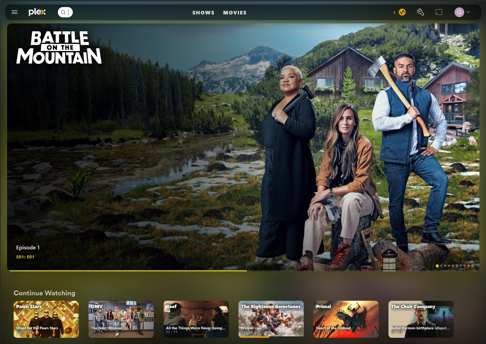
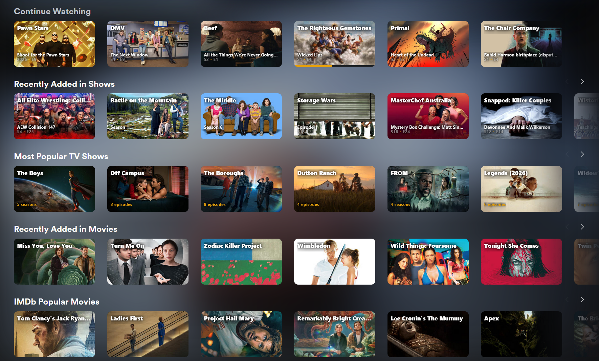
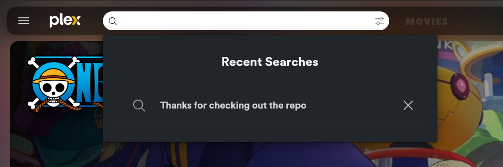

# Plex 16:9 Cards

A [Tampermonkey](https://www.tampermonkey.net/) userscript that restyles **Plex Web** (`app.plex.tv`) into a cinematic home screen — 16:9 backdrop artwork, a Recently Added hero carousel with stylized logo art, dynamic per‑show color, hover‑to‑play trailers, and a cleaner top navigation bar.

## Features

- **16:9 backdrop cards** — swaps Plex's portrait posters for wide landscape artwork, with the title / subtitle / episode overlaid and a soft shadow for legibility. Falls back to the original poster if no backdrop art exists.
- **Cinematic hero carousel** — a full‑width, auto‑advancing hero at the top of the home screen, built from your most recently added shows and/or movies. Prev/next arrows, dot navigation, a progress bar, and an ambient blurred backdrop. Click a slide to open the item.
- **Logo title art** — each slide shows the show's or movie's stylized logo (Plex's `clearLogo` art), Netflix/Disney+ style, instead of a plain text title — with an automatic fall back to text when no logo exists.
- **Dynamic color** — the hero extracts the dominant color from each slide's artwork and tints the accents (episode tag, progress bar, active dot, card glow) to match, shifting as the carousel rotates. Falls back to Plex gold when art has no vivid color.
- **Hover‑to‑play trailers** — hover a hero slide and, after a moment, a muted trailer fades in over the still; move away and it stops. Uses a local trailer file if your library has one, otherwise pulls Plex's own online trailer.
- **Streamlined top bar** — moves your pinned libraries into the header as bold, all‑caps links (the Plex logo still goes home), collapses the search box to an icon that expands on click, and reclaims the old sidebar space for content. The ☰ menu still opens the full library list.
- **Loading skeleton** — a subtle shimmer covers the initial paint so you don't watch Plex's layout reflow into place.

## Installation

1. Install the [Tampermonkey](https://www.tampermonkey.net/) browser extension (Chrome, Edge, Firefox, Safari).
2. **[Click here to install »](https://raw.githubusercontent.com/gl0ryus/Plex-Carousel/main/plexCardsUI.user.js)** — Tampermonkey opens an install tab; click **Install**.
3. Open [app.plex.tv](https://app.plex.tv) and head to your home screen.

New versions are delivered automatically by Tampermonkey whenever an update is pushed.

## Configuration

Open the script in the Tampermonkey dashboard and edit the `CONFIG` block at the top:

| Option | Default | What it does |
|---|---|---|
| `CAROUSEL_CONTENT` | `'shows'` | What the hero pulls from: `'shows'`, `'movies'`, or `'both'`. |
| `HERO_SLIDE_LIMIT` | `10` | Maximum number of slides in the carousel. |
| `HERO_INTERVAL_MS` | `6000` | Time, in ms, between auto‑advances. |
| `HERO_VIEWPORT_RESERVE` | `300` | Px reserved at the bottom so the first row peeks below the hero. Lower = taller hero. |
| `RECENT_ITEMS_LIMIT` | `50` | Items fetched per library when building the carousel. |
| `ENABLE_DYNAMIC_ACCENT` | `true` | Tint the hero accents with each slide's dominant artwork color (vs fixed Plex gold). |
| `ENABLE_HERO_TRAILERS` | `true` | Play a muted trailer in the hero when you hover a slide. |
| `HERO_TRAILER_DELAY_MS` | `1200` | Ms of hover before the trailer starts. |
| `ENABLE_ONLINE_TRAILERS` | `true` | If no local trailer file exists, pull one from Plex's online trailer service. |
| `ENABLE_TOP_NAV` | `true` | Set to `false` to keep Plex's stock top bar and sidebar. |
| `NAV_SEARCH_WIDTH` | `480` | Px width of the search box when expanded. |

A few more fine‑tuning constants (aspect ratios, opacities, debounce timing) are documented inline.

## Compatibility & caveats

- Works on **`app.plex.tv`** only. If you reach Plex through a custom domain or a local address (e.g. `http://192.168.x.x:32400/web`), add a matching `@match` line to the header.
- The carousel reads "Recently Added" directly from **your own Plex server**, using the token already present in the page.
- **Dynamic color** reads a tiny thumbnail of each slide's artwork and finds its dominant color entirely in your browser — nothing is uploaded.
- **Trailers** play a local extra if one exists; otherwise they're fetched from **Plex's own online trailer service** (`metadata.provider.plex.tv`) — the same source Plex Web itself uses for trailers. Coverage is good for movies and mainstream shows, thinner for niche/anime titles, and `ENABLE_ONLINE_TRAILERS = false` keeps it local‑only.
- This script hooks into Plex Web's internal markup, so a major Plex update can change those class names and temporarily break parts of the styling. Please [open an issue](https://github.com/gl0ryus/Plex-Carousel/issues) if something looks off and the selectors will be patched.

## License

[MIT](LICENSE) © gl0ryus
